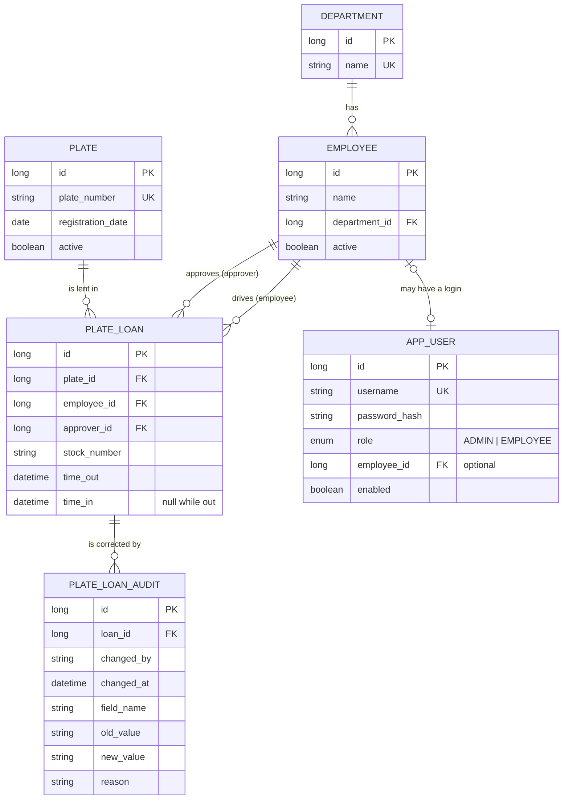

# Plate Tracker

Replaces the paper sheet for borrowing dealership licence plates. An employee picks a plate, a stock #, their name and the
receptionist who approved it, then clicks **Take licence plate**. The time out is stamped automatically. When the car is back,
they click **Return licence plate** and the time in is stamped.

Java 21 · Spring Boot 3.5 · Spring MVC + Thymeleaf · Spring Data JPA · Spring Security · H2 (dev) / MySQL (real)

> **Status:** first skeleton. It was written without being compiled or run (the sandbox it was generated in could not reach
> Maven Central), so the first thing to do is `mvn test`. See "First run" below.

## First run

```bash
mvn test                  # service rules + page rendering + role checks
mvn spring-boot:run       # http://localhost:8080
```

With the default (dev) settings it uses a file-based H2 database in `./data` and seeds sample data:

| Login | Password | Role | Notes |
|-------|----------|------|-------|
| `admin` | `admin123` | Super user | Full CRUD and the complete log |
| `driver1` | `driver123` | Employee user | Tied to "Alex Driver": can only borrow/return for himself |
| `kiosk` | `kiosk123` | Employee user | Shared login for a reception tablet: picks the employee from a dropdown |

### MySQL

```bash
docker compose up -d
DB_PASSWORD=platetracker APP_ADMIN_PASSWORD=choose-a-real-one \
  mvn spring-boot:run -Dspring-boot.run.profiles=mysql
```

The `mysql` profile turns off demo data and refuses to start without `APP_ADMIN_PASSWORD`, so there is no default password outside dev.

## Entities (first approach)



`PLATE_LOAN` is one row of the paper sheet. The sheet's *Date* column is the date part of `time_out`.

### Where this differs from your first list, and why

- **`PlateLoan` and `AppUser` are new.** The loan is the actual log. A login is separate from an employee because not every
  employee needs one, and a shared reception login has no employee.
- **`active` flags on plates and employees.** People leave and plates get retired, but old log rows must keep pointing at them,
  so they are deactivated rather than deleted. Delete is blocked once something references them.
- **Approver = an active employee in the Reception department.** Simple and matches the sheet. If it becomes too rigid, replace it with a
  `can_approve` flag on `Employee`.

### Decisions

1. **Stock #** stays free text (trimmed, upper-cased). A `Vehicle` entity (stock #, VIN, make/model, status) can be added later
   without changing the log: `stock_number` would become a foreign key.
2. **Several plates per employee** at the same time are allowed, as on the paper sheet.
3. **Approver** is any employee in the Reception department (active, when taking a plate; historical entries may name inactive people).
4. **Corrections:** admins can correct a log entry (employee, approver, stock #, time out, time in; the plate itself is fixed).
   A reason is mandatory and every changed field becomes a row in `PLATE_LOAN_AUDIT` (who, when, why, old and new value).
   Audit rows are insert-only. A returned entry can be marked "still out" again only if the plate isn't out on another entry.
5. **One open loan per plate** is enforced in `PlateLoanService` with a row lock on the plate (`PESSIMISTIC_WRITE`), because MySQL has no
   partial unique index. A database-level guarantee would need a generated column such as `open_plate_id` (= `plate_id` while `time_in IS NULL`) with a unique index.
6. **Time zone:** timestamps are generated with a `Clock` in `America/Toronto` (`app.timezone`), not the server's zone. The correction form works at minute precision.

## Database choice

Use a real relational database (MySQL as you suggested, or PostgreSQL, since the code is plain JPA). Reasons it fits this app better than the PantryID route:

- **The key rule is transactional.** "Is this plate already out?" must be checked and recorded atomically. A JSON blob store that you
  reach over HTTP has no transactions, row locks or constraints, so two people taking the same plate could both succeed.
- **The data is relational** (departments → employees → loans ← plates), and the log screen needs sorting, paging and joins. With a key/JSON store you would be
  re-implementing that in Java.
- **It's the experience that transfers.** JPA + a connection pool + migrations is what you'd use in a real enterprise project.
- If I understand correctly that PantryID refers to the Pantry JSON storage service, check its current size and rate limits and its inactivity policy before relying on it for anything that should keep working.

Practical path: H2 for development (already wired, zero install), MySQL in Docker for "real" runs (`docker-compose.yml`), then a small hosted MySQL/Postgres if you ever deploy it.

## Layout

```
src/main/java/com/platetracker
├── config/      Clock bean, first-run seeding (DataInitializer)
├── domain/      Department, Employee, Plate, PlateLoan, AppUser, Role
├── repository/  Spring Data repositories (entity graphs avoid lazy-loading surprises)
├── service/     PlateLoanService: take/return rules
├── security/    Form login, BCrypt, role rules (/admin/** = ADMIN only)
└── web/         PlateController (employee screen), admin/* (CRUD + log)
src/main/resources/templates   Thymeleaf pages
```

## Suggested next steps

1. Run `mvn test`, fix anything the first compile turns up.
2. Settle the open questions above, then switch from `ddl-auto=update` to Flyway migrations.
3. CSV export of the log.
4. Filters on the log (date range, plate, employee) and an "overdue: out for more than N hours" highlight.
5. A REST/JSON API layer if you want to try a React or mobile front end.
